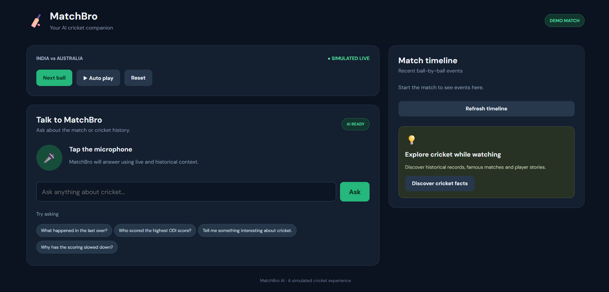
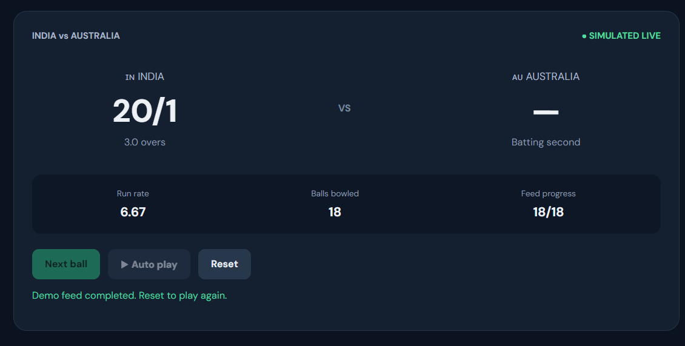
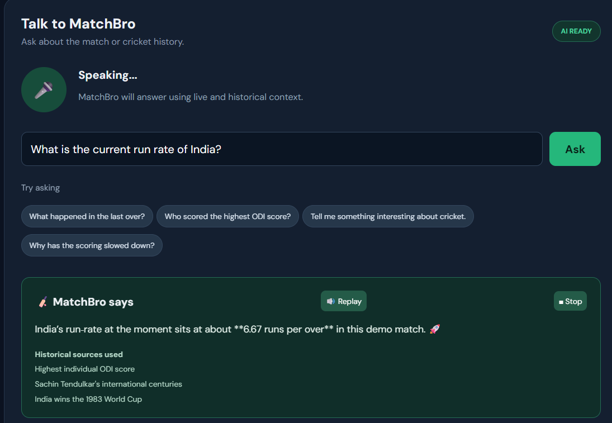
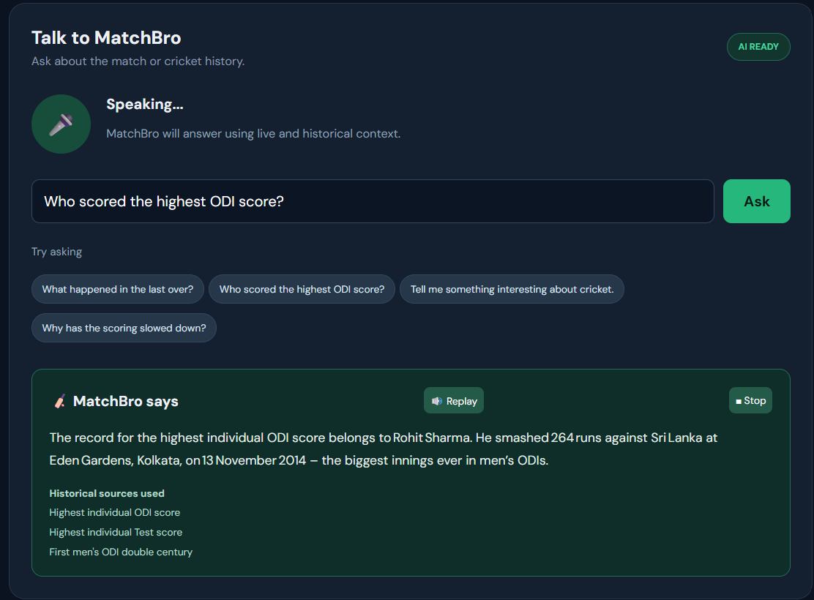

#  MatchBro AI

### Your AI-powered cricket companion. Every ball has a story.

**MatchBro AI** is a voice-first cricket companion designed to make
watching cricket more engaging. Whether the match is moving slowly or
you are curious about a player's historical records, MatchBro lets you
ask questions and get contextual answers through natural conversation.

It combines **live match context, historical cricket knowledge,
Retrieval-Augmented Generation (RAG), and voice interaction** to bring a
more interactive experience to cricket fans.

------------------------------------------------------------------------

##  Project Preview





###  Project Demo


[Watch the MatchBro AI
Demo](https://drive.google.com/file/d/1z38xpPqvcqVDJ0xBIagNoO2LauwT2RcJ/view?usp=sharing)


------------------------------------------------------------------------

##  The Problem

Watching cricket is not always equally exciting. During slow scoring
periods, long stretches of dot balls, or breaks in play, fans may lose
interest.

At the same time, cricket fans are naturally curious:

-   What happened the last time these two teams played?
-   What is this player's highest individual score?
-   Which player holds a particular cricket record?
-   What are some interesting historical moments related to this match?
-   What has happened in the current innings?

Traditional scoreboards provide statistics, but they don't offer an
interactive conversational experience.

##  The Solution

MatchBro AI acts as a personal cricket companion that understands both
the current match context and historical cricket knowledge.

Fans can interact with MatchBro using their voice or text to ask
questions about the ongoing match, explore cricket history, and discover
interesting facts.

###  Key Features

  -----------------------------------------------------------------------
  Feature                             Description
  ----------------------------------- -----------------------------------
   Voice Interaction                Ask questions using your microphone
                                      and receive spoken responses.

   Live Match Memory                Maintains timestamped ball-by-ball
                                      events and recent match context.

   Historical Cricket RAG           Retrieves relevant cricket facts
                                      and records using semantic search.

   Context-Aware AI                 Combines current match information
                                      with historical knowledge to
                                      generate relevant answers.

   Slow-Scoring Detection           Identifies a sequence of
                                      low-scoring deliveries and
                                      activates the Boredom Buster
                                      feature.

   Boredom Buster                   Suggests cricket-related questions
                                      and historical trivia during slow
                                      periods.

   Match Timeline                   Displays the sequence of deliveries
                                      and their outcomes.

   Text-to-Speech                   Converts AI responses into spoken
                                      audio.
  -----------------------------------------------------------------------

------------------------------------------------------------------------

##  Glimpse of the Application

Add screenshots of the following application sections as you complete
the UI.

### 1. Main Dashboard


### 2. Live Match Tracking




### 3. AI Conversation




### 4. Boredom Buster




------------------------------------------------------------------------

## 🏗️ System Architecture

MatchBro uses two complementary sources of contextual information:

1.  **Live Match Memory:** Structured, timestamped ball-by-ball events
    stored in SQLite.
2.  **Historical Cricket Memory:** Curated cricket knowledge indexed
    using FAISS for semantic retrieval.

When a user asks a question, the backend retrieves relevant information
from these sources and passes the context to the LLM.

``` text
                  ┌──────────────────────┐
                  │     Cricket Fan      │
                  └──────────┬───────────┘
                             │
                    Voice / Text Input
                             │
                  ┌──────────▼───────────┐
                  │    React Frontend    │
                  │   Voice + Dashboard  │
                  └──────────┬───────────┘
                             │
                        FastAPI Backend
                             │
                  ┌──────────▼───────────┐
                  │   AI Assistant       │
                  │  Context Processing  │
                  └──────────┬───────────┘
                             │
                  ┌──────────┴───────────┐
                  │                      │
        ┌─────────▼────────┐  ┌──────────▼─────────┐
        │ Live Match Memory│  │ Historical Cricket │
        │                  │  │       Memory       │
        │ SQLite Database  │  │                    │
        │ Ball-by-ball Data│  │ BGE Embeddings     │
        │ Match Timeline   │  │ FAISS Vector Index │
        └─────────┬────────┘  └──────────┬─────────┘
                  │                      │
                  └──────────┬───────────┘
                             │
                  ┌──────────▼───────────┐
                  │      Groq LLM        │
                  │ Contextual Response  │
                  └──────────┬───────────┘
                             │
                  ┌──────────▼───────────┐
                  │  Text / Voice Output │
                  └──────────────────────┘
```

------------------------------------------------------------------------

## 🔍 How It Works

### 1. Live Match Memory

MatchBro receives simulated ball-by-ball match events and stores them in
SQLite.

Each event contains information such as:

-   Match ID
-   Over and ball number
-   Batter and bowler
-   Runs scored
-   Delivery outcome
-   Wicket information
-   Match elapsed time

This allows the assistant to understand recent match events and answer
questions about the ongoing innings.

### 2. Historical Cricket RAG

Historical cricket knowledge is stored in a curated JSON dataset.

The indexing pipeline:

1.  Loads historical cricket records.
2.  Converts records into text.
3.  Generates embeddings using `BAAI/bge-small-en-v1.5`.
4.  Stores the embeddings in a FAISS vector index.
5.  Retrieves the most relevant records when a user asks a question.

### 3. Context-Aware Response Generation

When a question is received:

1.  The backend retrieves recent match events.
2.  It searches the historical cricket knowledge base.
3.  Relevant context is passed to the Groq LLM.
4.  The LLM generates a response grounded in the retrieved information.
5.  The response is displayed and can be spoken using browser
    text-to-speech.

### 4. Boredom Buster

MatchBro monitors recent deliveries to identify slow-scoring periods.

For the current prototype, six recent deliveries scoring three runs or
fewer, without a boundary, trigger the slow-period indicator.

The user can then explore historical cricket trivia or ask MatchBro a
question.

------------------------------------------------------------------------

## 🛠️ Tech Stack

  Component            Technology
  -------------------- -----------------------------
  Frontend             React.js, Vite, CSS
  Backend              Python, FastAPI
  LLM                  Groq API
  Embedding Model      BAAI/bge-small-en-v1.5
  Vector Database      FAISS
  Live Match Storage   SQLite
  Speech-to-Text       Web Speech API
  Text-to-Speech       Browser SpeechSynthesis API
  API Communication    REST APIs

------------------------------------------------------------------------

## 📂 Project Structure

``` text
MatchBro/
│
├── backend/
│   ├── app/
│   │   ├── services/
│   │   │   ├── assistant.py
│   │   │   └── historical_rag.py
│   │   │
│   │   ├── schemas/
│   │   │   └── requests.py
│   │   │
│   │   ├── database.py
│   │   ├── match_engine.py
│   │   └── main.py
│   │
│   ├── data/
│   │   ├── historical_cricket.json
│   │   ├── index/
│   │   └── matchbro.db
│   │
│   ├── scripts/
│   │   └── build_historical_index.py
│   │
│   ├── requirements.txt
│   └── .env.example
│
├── frontend/
│   ├── src/
│   │   ├── App.jsx
│   │   ├── main.jsx
│   │   └── index.css
│   │
│   ├── package.json
│   └── index.html
│
├── docs/
│   ├── images/
│   └── videos/
│
└── README.md
```

------------------------------------------------------------------------

## ⚙️ Installation and Setup

### Prerequisites

Make sure you have installed:

-   Python 3.11
-   Node.js and npm
-   Git
-   A Groq API key

### 1. Clone the Repository

``` bash
git clone https://github.com/your-username/MatchBro.git
cd MatchBro
```

### 2. Backend Setup

Navigate to the backend directory:

``` bash
cd backend
```

Create a virtual environment:

``` bash
py -3.11 -m venv venv
```

Activate it on Windows:

``` powershell
.\venv\Scripts\Activate.ps1
```

Install dependencies:

``` bash
pip install -r requirements.txt
```

### 3. Configure Environment Variables

Create a `.env` file inside the backend directory.

``` env
GROQ_API_KEY=your_groq_api_key
GROQ_MODEL=llama-3.3-70b-versatile
```

Get your API key from:

https://console.groq.com/keys

Use a model currently available in your Groq account.

### 4. Build the Historical Cricket Index

From the backend directory, run:

``` bash
python -m scripts.build_historical_index
```

This generates the FAISS index required for historical cricket
retrieval.

### 5. Start the Backend Server

``` bash
uvicorn app.main:app --reload
```

Backend API:

``` text
http://127.0.0.1:8000
```

API documentation:

``` text
http://127.0.0.1:8000/docs
```

### 6. Frontend Setup

Open a new terminal and navigate to the frontend directory:

``` bash
cd frontend
```

Install dependencies:

``` bash
npm install
```

Start the development server:

``` bash
npm run dev
```

Open the application:

``` text
http://localhost:5173
```

------------------------------------------------------------------------

##  Example Interactions

Here are some example questions you can ask MatchBro:

**Historical Cricket Questions**

-   Who holds the record for the highest individual ODI score?
-   When did India win its first T20 World Cup?
-   Who scored the first double century in men's ODI cricket?
-   Tell me something interesting about Sachin Tendulkar.

**Live Match Questions**

-   What happened in the last few deliveries?
-   How many runs has India scored?
-   Who is currently batting?
-   What happened in the previous over?

**Boredom Buster Questions**

-   Tell me a surprising cricket fact.
-   What is the most dramatic World Cup final?
-   Give me a cricket trivia question.
-   Tell me about an unforgettable last-over finish.

------------------------------------------------------------------------

##  Future Improvements

The current version is a working prototype built around simulated
ball-by-ball match data. The following features are planned for future
development:

-     Real-time cricket data API integration.
-     Live video and commentary-based event extraction.
-     Streaming match ingestion using WebSockets or Kafka.
-     Advanced match-context retrieval by over, player, and timestamp.
-     Personalized cricket trivia based on fan interests.
-     Multi-agent architecture for match analysis and historical
    research.
-     Support for multiple simultaneous matches.
-    Improved multilingual voice interaction.

------------------------------------------------------------------------

##  Current Prototype Limitations

-   Match events are simulated rather than sourced from a real live
    match.
-   Historical knowledge is based on a small curated dataset.
-   Match elapsed timestamps are simulated.
-   The current implementation is designed for a single local demo
    session.
-   Voice input depends on browser speech recognition support.

The prototype demonstrates the core idea of combining structured live
match memory with historical cricket RAG and conversational AI.

------------------------------------------------------------------------

##  Project Objective

The goal of MatchBro AI is to make cricket viewing more interactive by
connecting the excitement of the current match with the stories,
records, and moments that make cricket special.

**Because cricket is not just about the score. It's about every story
behind it.**

------------------------------------------------------------------------

## 👨 Author

**Jayesh Gund**

-   GitHub:   https://github.com/jayesh1808git
-   LinkedIn: https://www.linkedin.com/in/jayesh-gund-19790b276/

------------------------------------------------------------------------

*Built with ❤️ for cricket fans.* 
